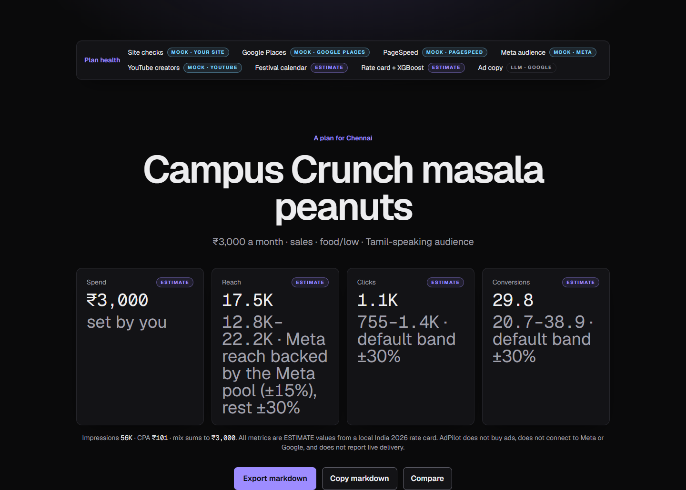
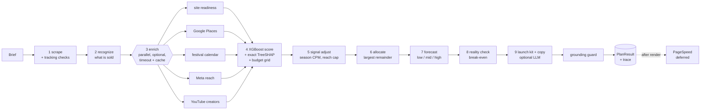
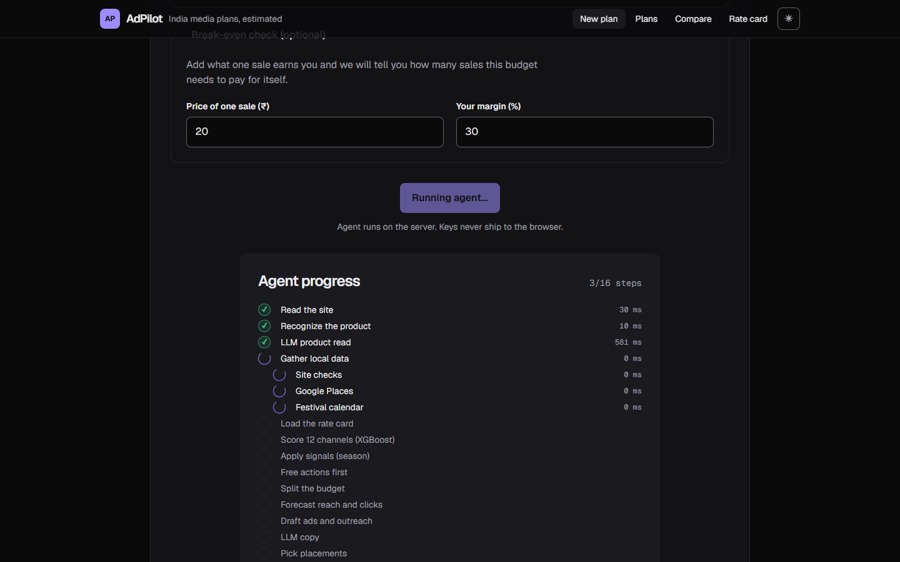
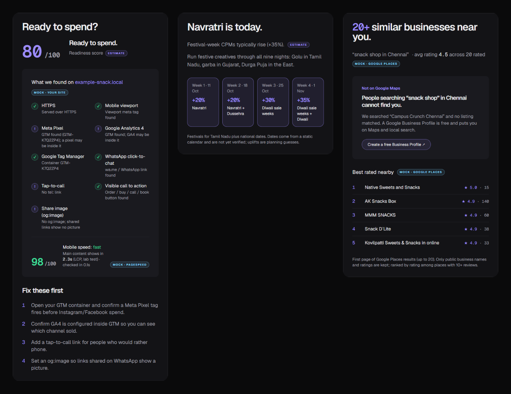
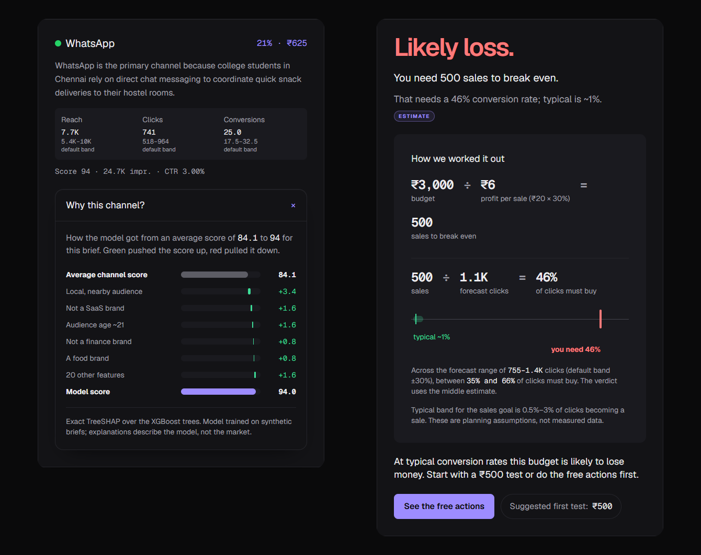
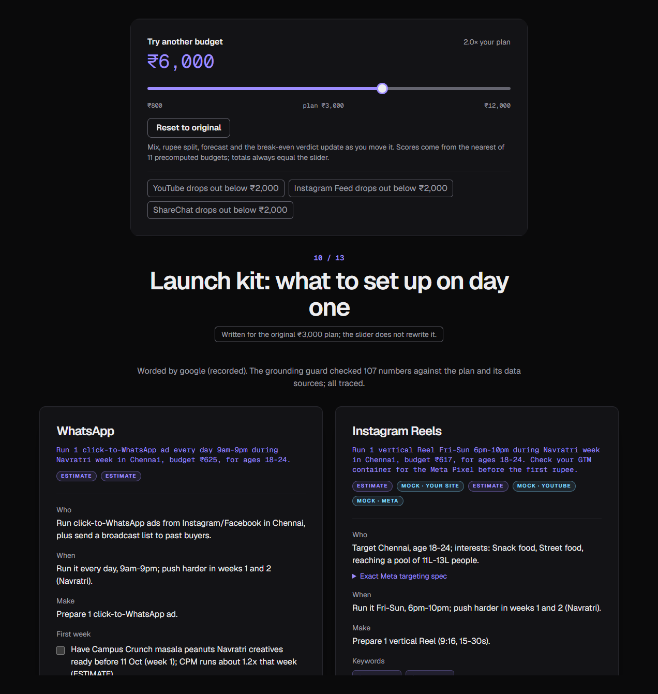

# AdPilot

> **The honest media planner for India's smallest businesses:** grounded in live local data, explainable, self-critiquing, and willing to say when not to spend.

AdPilot turns a short brief into a media plan. The brief covers the website, a monthly budget in rupees, city, audience, goal and an optional price and margin. The plan has a channel mix, a rupee split that sums exactly to the budget, a low / mid / high forecast, a break-even verdict, free actions to take before spending, a per-channel launch kit, ad angles and outreach scripts. An XGBoost model scores the 12 channels and exact TreeSHAP explains each score. Policy rules split the money, and an India 2026 rate card turns rupees into estimates. Live local data adjusts the plan: website checks, Google Maps competitors, festival timing, Meta audience size and local YouTube creators. An optional LLM only rewrites the words, and a grounding guard removes any number it cannot trace. AdPilot **does not buy ads** and never OAuths into Meta or Google. Every number on screen is badged **LIVE · source · date**, **ESTIMATE** or **MOCK**.

- Live v1: https://adpilot-olive-nine.vercel.app
- Repo: https://github.com/SHREE167/adpilot (v2 is on branch `v2`)

<p align="center">
  
</p>

## Key features

**Grounding** (real local facts, never invented)
- **Ready to spend?** checks the site for Meta Pixel / GA4 / GTM, HTTPS, viewport, WhatsApp, tap-to-call, a CTA and og:image. It also runs a deferred PageSpeed mobile score with LCP.
- **Your street** uses Google Places to find competitors for "{keyword} in {city}" and to check whether you are on Google Maps.
- **Timing** reads a festival and season window per state. Festival weeks raise the CPM (ESTIMATE), so they buy fewer impressions.
- **Who you can reach** shows the Meta audience pool (reachestimate bounds). Facebook + Instagram reach is capped at the pool.
- **Local voices** finds YouTube creators with 2k–200k subscribers in your city and topic, with a collab cost band.
- Every source is optional, time-boxed and cached. Each one shows LIVE, MOCK or Not connected in the Data sources footer.

**Intelligence**
- **XGBoost scorer**: 12 per-channel regressors over 25 features, with the trees walked in TypeScript.
- **Why this channel?**: an exact TreeSHAP waterfall (Lundberg 2018, Alg. 2) that adds up to the score.
- **Can this pay for itself?**: break-even units and the conversion rate they require, compared with a benchmark band. The verdict is Healthy, Tight or Likely loss.
- **Before you spend anything**: up to 4 zero-rupee actions, each with a sourced *why*.
- **Launch kit**: targeting, timing, creative count, keywords, a first-week checklist and one metric to watch per channel.

**Interaction**
- **Budget slider** from 0.25× to 4×: the browser re-runs allocate + forecast + reality check in under 1 ms per move.
- **Forecast ranges**: low / mid / high on reach, clicks and conversions everywhere they appear.
- **Live pipeline progress**: each agent step streams as it runs.
- Compare view, an editable rate card, and a Midnight Pro dark/light theme.

**Proof**
- **Agent trace**: every step and every source is a span with its status and ms.
- **Grounding guard**: every number in the LLM or template text must trace to the plan or a signal, or it is removed.
- **Eval harness**: `npm run eval` compares v1 and v2 on 20 golden briefs, fully offline.

## v1 vs v2 in numbers

From [`eval/report.md`](eval/report.md): 20 golden briefs, mock mode, no keys, no network.

| Metric | v1 | v2 |
| --- | --- | --- |
| Category accuracy | 100% (20/20) | 100% (20/20) |
| Specificity (grounded facts per plan) | 0.0 | 13.9 |
| Grounding (numbers traceable) | 100% (88/88) | 100% (1805/1805) |
| English-only lines | 100% (597/597) | 100% (1302/1302) |
| Explanation additivity | 0% (zero-ablation) | 100% (exact TreeSHAP, 240 checks) |
| Slider: every gated check passes | no slider | 20 / 20 briefs |
| Ranges ordered (low ≤ mid ≤ high) | 100% (351/351) | 100% (365/365) |
| Reality check coverage | 0% | 70% (14/20; the rest give no price) |
| Diversity (mean Jaccard distance of mixes) | 0.62 | 0.62 |
| Latency p50 (ms, offline) | ~12 | ~82 |

Diversity is unchanged because v2 does not change which channels the scorer picks. That is the job of the M6 critic and explore slice (see [Future work](#future-work)).

## Architecture



`runAgent` in `lib/agent.ts` runs every step inside a trace span. Details are in [docs/ARCHITECTURE.md](docs/ARCHITECTURE.md).

## Tech stack

- Next.js 15 App Router, React 19, TypeScript, Tailwind CSS v4, deployed on Vercel
- XGBoost (trained in Python, `ml/train.py`), with inference and TreeSHAP in pure TypeScript
- Recharts for charts, anime.js v4 for motion, Geist / Geist Mono fonts
- Optional: Postgres (`@vercel/postgres`) for saved plans, the rate card and the API cache
- Optional LLMs: Gemini and Groq, English only. OpenAI is not used.
- Tests use `node:test` through a no-dependency TS runner. No test framework is installed.

## Setup

Requirements: Node.js 20 or newer, and git.

**Windows (PowerShell or cmd)**

```powershell
git clone https://github.com/SHREE167/adpilot
cd adpilot
git checkout v2
npm install
copy .env.example .env.local
npm run dev
```

**macOS / Linux**

```bash
git clone https://github.com/SHREE167/adpilot
cd adpilot
git checkout v2
npm install
cp .env.example .env.local
npm run dev
```

Open http://localhost:3000 and click a sample brief (₹3,000 student snack · Chennai, or ₹40,000 B2B SaaS · Bengaluru). No key is needed for a full plan.

## Environment variables

All of these are optional. With none of them AdPilot still returns a complete plan from the model, the rate card, the festival calendar, the site checks and template copy. Copy `.env.example` to `.env.local`.

| Variable | Unlocks |
| --- | --- |
| `GOOGLE_GENERATIVE_AI_API_KEY` | Gemini rewrites the launch kit and ad copy (first choice); fallback for product recognition. `GOOGLE_MODEL` overrides the default model. |
| `GROQ_API_KEY` | Groq for product recognition (first choice); fallback for the kit and copy. `GROQ_MODEL` overrides the default model (`openai/gpt-oss-20b`). |
| `POSTGRES_URL` | Durable plans, rate-card edits and the `adpilot_cache` table. Without it: server memory + browser localStorage. |
| `PAGESPEED_API_KEY` | Mobile speed score + LCP in "Ready to spend?" (deferred, cached 24h). |
| `GOOGLE_PLACES_API_KEY` | "Your street": local competitors + "are you on Google Maps?" (cached 7d; needs billing, so set a quota). |
| `YOUTUBE_API_KEY` | "Local voices": YouTube creators (101 of 10,000 daily units per uncached plan; cached 7d). |
| `META_ACCESS_TOKEN`, `META_AD_ACCOUNT_ID`, `META_API_VERSION` | "Who you can reach": Meta audience pool + FB/IG reach cap. All three are needed. |
| `ADPILOT_MOCK_APIS` | `1` = every data source reads `fixtures/api/` (offline). Local only. |

Keys are read only from `process.env` on the server. The browser never sees them.

## Mock mode (offline demo)

Put `ADPILOT_MOCK_APIS=1` in `.env.local` and restart `npm run dev`. Every source then reads `fixtures/api/<source>/<key>.json`, falling back to `default.json`. The fixtures are recorded real responses: Places, YouTube, PageSpeed, plus one Gemini and one Groq rewrite of the demo kit. The Meta fixture is hand-written until a token exists. Mocked numbers are badged **MOCK**. Fixture files are not bundled into Vercel functions, so do not set this on Vercel.

The 5-minute demo in [docs/DEMO.md](docs/DEMO.md) runs entirely in mock mode.

## Scripts

```bash
npm run dev          # local dev server (turbopack), http://localhost:3000
npm run build        # production build
npm run start        # serve the production build
npm run lint         # eslint
npx tsc --noEmit     # type check
npm test             # node:test unit tests (no extra deps)
npm run eval         # v1 vs v2 on 20 golden briefs, offline -> eval/report.md
npm run record -- <youtube|groq|gemini|meta>   # ONE live call with .env.local keys -> mock fixture
npm run train-model  # retrain XGBoost (needs ml/.venv with Python; Colab steps in ml/train.py)
```

## Routes

| Path | What |
| --- | --- |
| `/` | New plan form with live pipeline progress |
| `/plans`, `/plans/[id]` | Saved plans and the result dashboard |
| `/compare?a=&b=` | Two plans side by side |
| `/rate-card` | Edit CPM / CPC / CTR (ESTIMATE) |
| `POST /api/plan` | Streams trace events (NDJSON), then the plan. The form falls back to the `createPlan` Server Action. |

## Screenshots

These live in `docs/screenshots/`. See [docs/screenshots/README.md](docs/screenshots/README.md) for what each one shows.

| | |
| --- | --- |
|  |  |
|  |  |
|  | |

## Limitations

- **Synthetic training data.** The scorer learned from generated briefs, so TreeSHAP explains the model, not the market. The UI says so next to the waterfall.
- **Rate card, benchmarks, festival multipliers and creator rates are ESTIMATEs.** They are editable JSON. Festival dates are `verified: false` until someone checks them.
- **The Meta audience fixture is hand-written** until a Meta token is added and `npm run record -- meta` replaces it.
- **Channel picks match v1.** v2 changes prices, ranges, timing, words and verdicts, not which channels win, so diversity is equal.
- **Impressions can dip when the slider adds a channel.** The mix broadens and total impressions can fall (12/20 briefs are monotone).
- **Ranges are a default band** (±30%, or ±15% when backed by the Meta pool), not calibrated intervals.
- **Static scraping** cannot see pixels injected by GTM, so AdPilot says "a pixel may be inside it" rather than "no pixel".
- **Creators are YouTube only**, because there is no public Instagram creator search.

## Future work

**M6: learn from real results**
- **F12 critic agent**: one structured review round of the plan with allow-listed fixes. Each change is shown in the trace.
- **F13 actuals loop**: enter real spend, clicks and sales after a campaign. The rate card shrinks toward the results (Postgres).
- **F14 calibrated intervals**: ranges switch from the default band to intervals fitted on actuals (at least 5 points).
- **F20 explore slice**: a small Thompson-sampling test budget for an under-tried channel. It stays off until 3 actuals exist.
- **(F6) search demand**: Google Trends via SerpAPI.

**M7: share and show**
- **F17 ad previews**: Instagram post, WhatsApp bubble and Google search ad mockups with per-format character limits.
- **F18 share page**: a print-friendly one-page plan and a "Copy WhatsApp summary" (under 700 characters).
- **F15 trace page**: `/plans/[id]/trace` timeline UI over the trace the plan already stores.

## Credits

- Built by Saivignesh Pandian (Sai) as a college project, with Claude Code as a pair programmer.
- XGBoost: Chen & Guestrin, *XGBoost: A Scalable Tree Boosting System* (KDD 2016).
- TreeSHAP: Lundberg, Erion & Lee, *Consistent Individualized Feature Attribution for Tree Ensembles* (2018), Algorithm 2.
- Data sources: Google PageSpeed Insights, Google Places API (New), YouTube Data API v3, Meta Marketing API (reachestimate).
- Built with Next.js, React, Recharts, anime.js and the Geist typeface.
